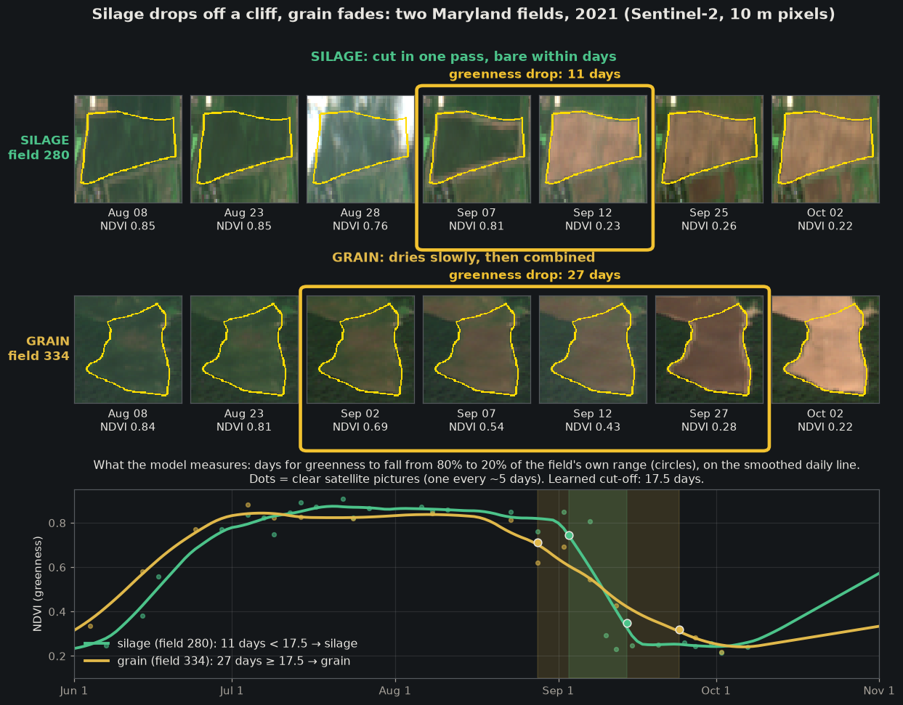

# Grain or silage? Corn harvest type from public data

Team Kernel's entry to **Hack the Harvest 2026**, a two-day data science hackathon run by UC Davis (Aggie Square,
Sacramento, 14–15 November 2026) on a problem set by **USDA's National Agricultural Statistics Service (NASS)**.

Everything runs from one notebook, [`grain-or-silage.ipynb`](grain-or-silage.ipynb), on the public data in `data/`.
This README covers the context, the data and how each model works. The notebook covers how to run the models and
read their output.

## The problem

US corn is harvested in one of two ways:

- **Grain:** the crop dries in the field and a combine takes only the kernels.
- **Silage:** the whole green plant is chopped and fermented as cattle feed.

From space the two fields look identical until harvest day. NASS publishes the official split only in **January**, after
markets have already moved. Farmers report their plans in summer, but drought or a dairy short of feed can switch a
field late in the season.

The organizers asked for:

1. **Silage or grain** for a corn field.
2. **As early in the season as possible.** NASS's figure comes in January (December at the earliest), so an answer in
   October or November is worth much more.
3. **Acres of grain and of silage**, for each state and for the US.

Only public data was allowed. The organizers provided field labels for one USDA research farm in Maryland, and scored
acreage against NASS's 2025 final numbers.

The original hackathon material is in `DOCS/`:
- `Hack the Harvest Saturday Deck.pdf`: the organizers' kickoff slides, with the challenge and the judging criteria.
- `Kernel_USDA_Briefing.pdf`: our notes from the USDA NASS briefing on Saturday morning.

## Results

| Model | Question | Test | Result |
|---|---|---|---|
| **A-G9** | Grain acres by state | Forecast every year as of 15 Nov, 2017–2024; 2025 scored once | State error **1.7%** (2025: 1.6%); US error **1.0%** (2025: −0.9%). NASS's own November forecast: 1.66% / 0.82% |
| **B-S6** | Silage acres by state | Same | State error **12.8%** (2025: 13.1%); US error **3.4%** (2025: +2.1%). Same as last year: 14.5% / 4.1% |
| **Caveman rule** | Silage or grain, per field | Learned on 801 Quebec fields, tested on USDA's 44 Maryland field-years | **42/44 correct (95.5%)**. Always guessing grain: 72.7% |

"State error" = summed absolute state misses ÷ true total acres. "US error" = error of the US total.

## Data

All files are in `data/` (about 9 MB). Every source is public.

| File | What | Source |
|---|---|---|
| `BARC_Corn.2021-2023.gpkg` | 83 field outlines on USDA's Beltsville Agricultural Research Center farm, Maryland, with each year's harvest type (44 labeled field-years: 32 grain, 12 silage) | Organizers (USDA ARS); Kraatz et al., *Sensors* 23(20) 2023; Dulaney et al., *Agrosystems, Geosciences & Environment* 7(1) 2024 |
| `labels/quebec_corn_2023.parquet` | 801 corn parcels in three areas of Quebec, Canada (Saint-Hyacinthe, Nicolet, Haut-Saint-Laurent), each declared grain or silage by the farmer in 2023 (163 silage) | La Financière agricole du Québec, declared-parcel database |
| `satellite/*.parquet` | NDVI per field per Sentinel-2 picture (date, share of clear pixels, median NDVI), March–December | ESA Sentinel-2 L2A via Microsoft Planetary Computer |
| `nass/*.csv` | State corn acres harvested for grain and for silage, and grain yield: finals and in-season forecasts, 2000–2026 | USDA NASS Quick Stats |
| `fsa/*.csv` | Corn acres certified by farmers to the Farm Service Agency, by state, intended use and release date, 2009–2026 | USDA FSA crop acreage data |
| `regions/regions.parquet` | US county outlines and the Quebec outline | US Census cartographic boundaries 2023 (1:5M); Natural Earth admin-1 |
| `regions/winter_vegetation.csv` | For every US county and for Quebec: average Nov–Dec temperature 2000–2025 and whether winters allow a green crop (≥ 4 °C) | NOAA nClimGrid-Daily county means (US); Open-Meteo ERA5 archive (Quebec) |

**NDVI** is a greenness score computed from two of Sentinel-2's bands: NDVI = (near-infrared − red) / (near-infrared + red).
It is about 0.2 for bare soil and about 0.9 for full green corn. Living leaves reflect a lot of near-infrared light,
which the eye can't see. Sentinel-2's two satellites photograph every field on Earth about every 5 days at 10 m per pixel
(a 16-acre field is about 650 pixels). Clouds hide some passes: our fields had 13–29 clear pictures from June to October.

## Model 1: A-G9, grain acres

**Idea:** by mid-July, farmers certify to USDA's Farm Service Agency (FSA) how many acres they planted and what each
field is for. Those counts differ from NASS's final numbers, but by a stable amount in each state. So learn each state's
usual gap and correct for it.

For a forecast of year *t* made on 15 November:

1. Take the newest FSA release of year *t* published by that date, and its acres planted with intended use "grain", by state.
2. For each state, take the ratio NASS final grain acres ÷ FSA grain acres in each of the last three years; use the median.
3. Forecast = FSA acres × that ratio. If the ratio is implausible (outside 0.25–4) or the state has no FSA data, use
   last year's NASS final instead.
4. One national correction: scale those states so their total equals their FSA total × the median national NASS/FSA
   ratio of the last three years.

**Uses no NASS data from year *t*.** Inputs are this year's FSA releases and NASS finals of earlier years only. The FSA
release dates are the dates each file was published, so the backtest never sees a file before it existed. On 2017–2024
it ties NASS's own November forecast (1.69% vs 1.66% state error); in September it beats it (1.67% vs 2.53%).

## Model 2: B-S6, silage acres

**Idea:** a state's silage acres swing 10–20% a year. Much of that is noise in NASS's survey that reverses the next
year (consecutive changes correlate at −0.40; pure noise would be −0.5). So the best guess of a normal year is a
smoothed level, not last year's figure. The one real shock is drought: when the grain crop fails, farmers chop it for
silage.

```
forecast_t  = exp( smoothed log of past "normal" acres ) + chopped_t
chopped_t   = gamma × max(0, shortfall_t − 0.10) × last year's grain acres
shortfall_t = 1 − (NASS November yield forecast) / (linear trend of the previous 10 final yields)
normal acres = past silage acres minus their own chopped acres (never below 30% of the reported value)
```

- `alpha` is the smoothing weight, picked from 0.20–0.90.
- `gamma` is the share of exposed grain acres that gets chopped, picked from 0–0.20.
- Both are re-chosen **every year on earlier years only**, by mean state error. Only two numbers are fitted.
- It uses NASS's in-season **yield** forecast, which is public by 15 November, but not its acreage forecast.

**Why it stops near 13%:** every method the team tried lands in the same place: ridge, robust regressions, gradient
boosting, ensembles, and a satellite corn-share signal. The error is concentrated in the big dairy states, and most of
it is survey noise that no public input explains. The US total is much better: the drought term turns a national
weather shock into acres.

## Model 3: the caveman rule, one field at a time



*Two USDA Maryland fields in 2021, seen by Sentinel-2. The silage field goes from green to bare between 7 and 12
September; the grain field browns over most of September. Yellow boxes frame the pictures taken during each drop. The
bottom panel shows what the model measures: the days
greenness takes to fall from 80% to 20% of the field's own range (circles, shaded span). Under 17.5 days → silage.*

**Rule 1: how fast the field loses its green.**

- **Silage** is chopped in one pass, and the whole plant (stalks, leaves and ears) leaves the field, so its NDVI falls
  off a cliff.
- **Grain** corn ripens slowly: from space the field fades from green to yellow over weeks before the combine comes.

For each field-year:

1. Keep the Sentinel-2 pictures where at least 40% of the field's pixels are clear. Pixels count only if they are
   classified as vegetation or bare soil and lie fully inside the field (outline shrunk 10 m).
2. Join the field's median NDVI per picture into a daily line (straight lines between pictures, 15-day smoothing).
3. Measure **X = the days NDVI takes to fall from 80% to 20% of the field's own range** after its peak. The range runs
   from the spring low (early April to mid June) to the season's greenest day.
4. **Silage if X < cut-off**, else grain.

The cut-off is the only learned number. To learn it, try every value between the observed X's and keep the one with
the best silage F1. It comes out at **17.5 days** whether learned on Quebec or on Maryland.

**Rule 2: something green in winter, used only where rule 1 is unsure.** After an early silage cut there is time to sow
a cover crop, so the field can be green again in November–December (NDVI > 0.65). But a winter crop is weak evidence on
its own. Rough national estimates, based on USDA ERS cover-crop reports:

| 100 random US cornfields (8% silage) | Share |
|---|---|
| Silage + winter crop | 2.0% |
| Silage, no winter crop | 6.0% |
| Grain + winter crop | 7.4% |
| Grain, no winter crop | 84.6% |

These are estimated joint shares, not measured statistics. Sources: *Rates of Cover Crop Adoption Vary Depending on
the Cash Crop Being Planted* (USDA ERS, 2021); *Farmers Increase Cover Crop Usage Over Past Decade for Some Major Cash
Crops* (USDA ERS, 2025); *Cover Crop Trends, Programs, and Practices in the United States* (USDA ERS, 2021).

A winter crop is about 3× more likely after silage than after grain (2.0/8 vs 7.4/92). Across all fields it lifts the
chance of silage only from 8% to about 21% (2.0 / 9.4), so it can't decide a field by itself. On a field where rule 1
is a coin flip, the same 3× moves it to about 75%. So rule 2 is applied only when:

- **the field is borderline:** X between 17.5 and 20.5 days. Far from the cut-off, rule 1 decides alone.
- **its county's winters allow a green crop:** average Nov–Dec temperature ≥ 4 °C, roughly where winter rye still
  grows. The field's centre is matched to its county (or to Quebec) in `regions/regions.parquet`, then looked up in
  `winter_vegetation.csv`. In colder places snow hides any crop, so the rule is switched off.

When both hold and the field is green in winter, the call flips to silage.

**Testing.** USDA's Maryland labels were held out entirely:

| Learned on | Tested on | Correct | Notes |
|---|---|---|---|
| Quebec (801) | Maryland (44) | **42/44 = 95.5%** | Silage precision 1.00, recall 0.83; always-grain 72.7% |
| Maryland, 2 of 3 years | Maryland, the 3rd (each in turn) | 42/44 = 95.5% | Same cut-off, 17.5 |
| Maryland (44) | Quebec (801) | 718/801 = 89.6% | Always-grain 79.7%; rule 2 off (cold winters) |

- **Rule 2 changes nothing on this data.** The two missed Maryland silage fields aren't borderline: one takes 28 days
  (a cloud-haze dip stretches its drop), the other has no measurable drop at all. The six grain fields just above the
  cut-off (20–22 days) have winter NDVI of 0.25–0.44, so none is wrongly flipped. Applying rule 2 to every field would
  score 43–44/44 on Maryland, but that version was tuned by hand on the same 44 fields, so it isn't used.
- **Quebec misses:** about a third of Quebec's declared silage fields dry down slowly before being cut, or were
  switched to grain after the declaration. Their curves look like grain.

**What we tried that didn't work:**
- **Season length** (harvest minus green-up), the first version of the idea: 50% silage F1. Grain dries down in the
  same weeks silage is cut.
- **Crop residue after harvest (NDTI):** weaker than the drop speed.
- **Logistic regression on eight greenness and residue signals:** worse in Quebec than the single rule.
- **NVIDIA Nemotron labeling true-colour pictures** as no crop / standing / harvested: 61%. In a 10 m colour picture,
  fresh silage stubble and dry corn look alike, so silage harvests came out about 2½ weeks late.

## Limits

- **Small field test:** 44 Maryland field-years is a small sample. Quebec labels are farmers' declared intentions,
  not observed harvests.
- **Winter data:** rule 2 needs pictures through December, which conflicts with early answers. Rule 1 alone calls a
  field within days of its harvest (early October in Maryland).
- **Fields don't add up to good acres:** rolling field calls up to state acres doesn't work. Where silage is ~2% of
  corn (Iowa), even a 4% false-alarm rate on grain fields outnumbers the real silage fields. That is why acres come
  from models 1 and 2.
- **Untested elsewhere:** the 4 °C winter threshold is a stated assumption, not fitted. The rules are untested in
  regions with other harvest calendars, such as Texas, which cuts silage in early August.

## Run it

```
pip install -r requirements.txt
jupyter lab grain-or-silage.ipynb      # Run All: about 20 seconds, offline
```

Only `classify_field(...)` in the last section goes online, to download a new field's Sentinel-2 pictures. No account
or key is needed.

## History

This branch is a cleaned-up portfolio version. The full hackathon repository is on branch
[`hackathon-2026-submission`](../../tree/hackathon-2026-submission), unchanged: every experiment, the team's other
models, the agents' coordination files and the submitted notebook. The acreage models were built by teammates on team
Kernel; the caveman rule and its tests come from the `autoresearch/` experiments there.
